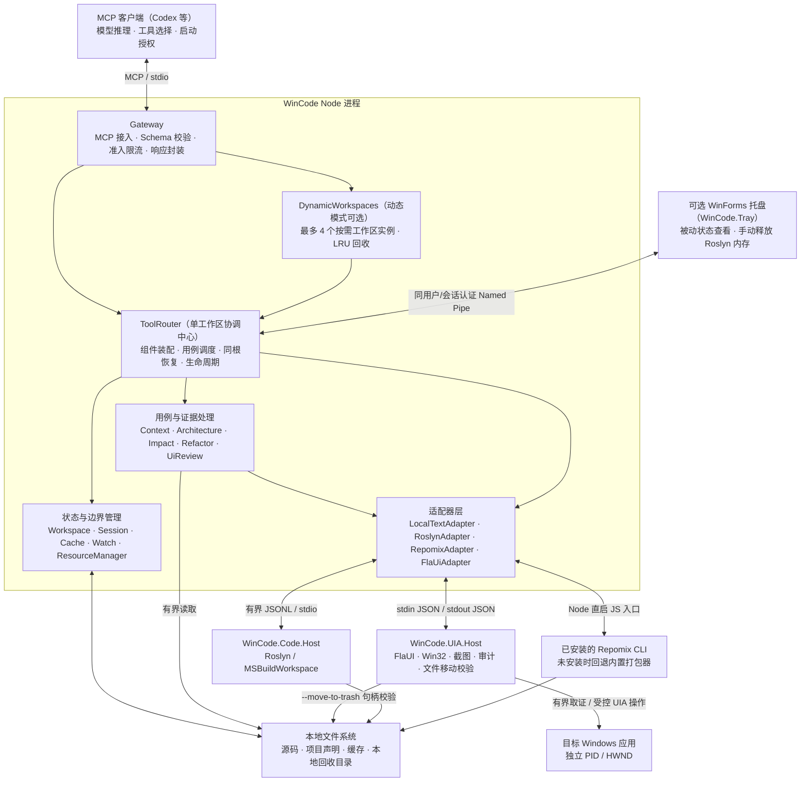
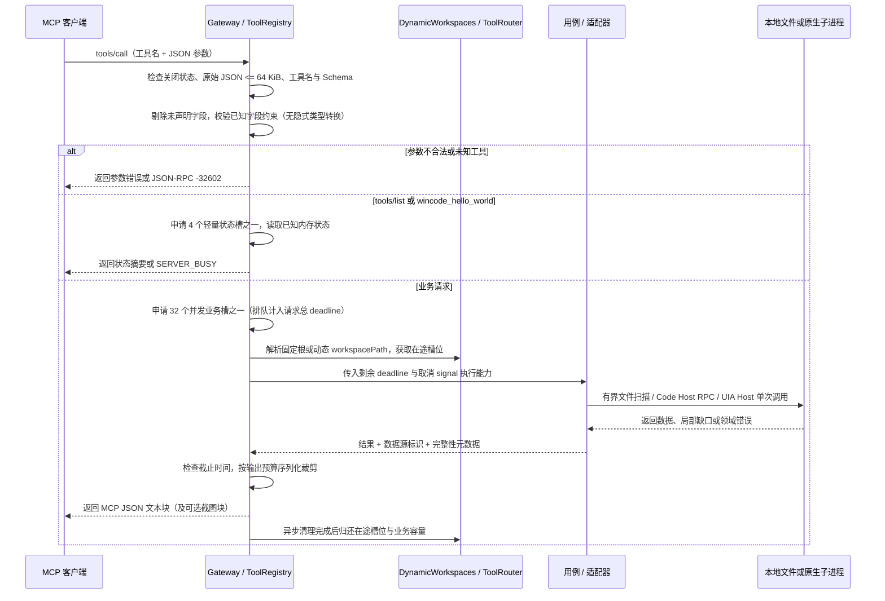
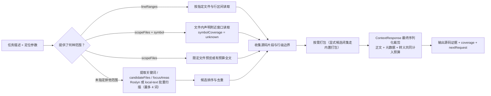
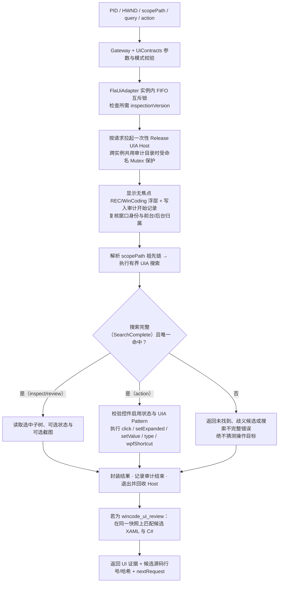

# WinCode 架构与数据流说明

适用源码版本：**0.17.1**。本文描述当前仓库源码中已实现的分层架构、请求数据流、资源上限与工程边界；未完成的改进与待验证项统一维护在 [迭代计划](docs/next-iteration.md)，版本演进记录见 [CHANGELOG](CHANGELOG.md)。

> 注意区分三个独立状态：**源码版本**、**磁盘构建产物**（`dist/` 与原生 Release 目录）以及**客户端当前连接的进程**。更新源码或构建产物后，必须由客户端重连 MCP 服务器才能加载新进程。

## 1. 整体定位与模块分层

WinCode 是运行在本机的 **MCP 工具网关**：接收编程智能体的结构化请求，采集有界的代码或桌面 UI 证据，并将正文与完整性/不确定性元数据一并返回。模型推理位于客户端侧；WinCode 自身不包含模型推理服务或向量数据库。

整体采用**分层网关 + 外部工具适配器 + 进程外原生辅助程序（Host）**结构。原生辅助进程的隔离用于控制超时、故障回收与依赖边界，**不构成操作系统级安全沙盒**。

### 核心模块职责

| 层 / 模块 | 核心职责 | 设计边界与源码入口 |
| --- | --- | --- |
| 启动层 | 解析 CLI 参数（工作区模式、Git/UI/Roslyn 授权），装配服务并管理优雅退出 | [index.ts](src/index.ts) |
| 可选 Skill 客户端 | 持久终端按需连接、会话复用、本地结果文件回执及客户端只读/单层展开 UI 编排 | [SkillSession.ts](src/Client/SkillSession.ts)、[SkillSessionCli.ts](src/Client/SkillSessionCli.ts)、[ReadonlyUiRecipes.ts](src/Client/ReadonlyUiRecipes.ts) |
| Gateway | 生成连接级工具列表与 Schema、剔除未知参数、控制并发准入与响应裁剪 | [McpServer.ts](src/Gateway/McpServer.ts)、[ToolRegistry.ts](src/Gateway/ToolRegistry.ts) |
| 工作区路由与协调 | `ToolRouter` 绑定单个工作区根并管理其锁与恢复；`DynamicWorkspaces` 在动态模式下按请求目录调度多个 `ToolRouter` | [ToolRouter.ts](src/Core/ToolRouter.ts)、[DynamicWorkspaces.ts](src/Core/DynamicWorkspaces.ts) |
| 核心契约与边界 | 定义符号、上下文、UI 操作、取消信号、文件系统与句柄回收站边界 | [CodeQueries.ts](src/Core/CodeQueries.ts)、[UiContracts.ts](src/Core/UiContracts.ts)、[FileSystemBoundary.ts](src/Core/FileSystemBoundary.ts)、[TrashFileMove.ts](src/Core/TrashFileMove.ts) |
| 用例层 | 项目图分析、上下文组装、变更影响评估、重构检查清单、UI→源码候选映射 | [Context.ts](src/Core/Context.ts)、[CompositeTools](src/CompositeTools) |
| 适配器层 | 封装子进程协议、超时、取消与错误分类；严格区分 `local-text` 与 `roslyn` 数据来源 | [Adapters](src/Adapters) |
| 原生辅助程序 | `WinCode.UIA.Host`（UIA 取证/操作、窗口截图、审计、普通文件校验移动）；`WinCode.Code.Host`（Roslyn 语义快照）；`WinCode.Tray`（可选托盘） | [WinCode.UIA.Host](tools/WinCode.UIA.Host/Program.cs)、[WinCode.Code.Host](tools/WinCode.Code.Host/WorkspaceSession.cs)、[WinCode.Tray](tools/WinCode.Tray/Program.cs) |
| 构建与交付层 | 锁定依赖还原、原生 Release 发布、回归验证、交付清单与 Skill 同步 | [check.mjs](scripts/check.mjs)、[delivery-manifest.mjs](scripts/delivery-manifest.mjs)、[sync-skill.mjs](scripts/sync-skill.mjs) |

**工具暴露策略**：`ToolRegistry` 根据启动配置生成连接级工具表并计算 `schemaHash`。默认标准连接发布 **20 个**工具名称（19 个主工具 + 列出的别名 `wincode_analyze_change_impact`，另有隐藏兼容别名 `wincode_workspace_open`）；启用 `--background-ui` 时移除 `wincode_ui_click` 与 `wincode_ui_set_expanded`（18 个）；在此基础上通过 `--ui-shortcut-window` 绑定后台窗口后，额外暴露 `wincode_ui_shortcut`（19 个）。`ExtensionManager` 仅保留内部兼容接口，无外部插件加载机制。

## 2. 请求处理生命周期与准入限流

### 准入、超时与取消规则

- **单一契约源与字段清洗**：`WorkspaceTools`、`CodeTools`、`UiTools` 在同一处定义 Schema、附加校验与执行器。协议层容忍未声明字段但会在进入业务逻辑前递归剔除，且不对已声明字段做字符串转数字等隐式转换。
- **双通道容量控制**：每个 Gateway 实例最多同时受理 **32 个**未完成业务请求与 **4 个**轻量状态请求（`hello` / `tools/list`）；原始参数在归一化前限制为 **64 KiB UTF-8 JSON**。满额时直接返回 `SERVER_BUSY`（`workStarted: false`），不抢占在途请求。
- **公平互斥与截止时间传递**：Roslyn、UIA 与工作区恢复各自维护 FIFO 互斥队列，取消排队中的请求会立即移除等待节点；已进入执行的请求取消后，须等待子进程或句柄实际清理完毕才归还容量。只读工具若在返回后已超过请求 deadline 则按超时处理；具有副作用的工具（如文件移入回收站或已执行的 UI 动作）在收尾阶段超时仍保留实际已发生的状态结果（如 `completed` / `partial`），避免调用方误判为“未执行”而重复操作。

## 3. 代码分析与上下文数据流

### 3.1 三类代码证据及其边界

| 证据类别 | 生产模块 → 消费模块 | 保留的关键边界信息 |
| --- | --- | --- |
| 符号与引用 | `LocalTextAdapter` / `RoslynAdapter` → `Context`、`Impact`、`Refactor` | `source`（`local-text` 或 `roslyn`）、快照绑定的 `location`、`queryComplete`、歧义候选及裁剪计数 |
| 源码片段 | 文件读取 / 打包 → `ContextResponse` | 实际起止行、尾行是否完整（`endLineComplete`）、`coverage`、缺失区间与续读 `nextRequest` |
| 项目声明图 | `ProjectDiscovery` / `DotNetGraph` → `ArchitectureAnalyzer` | 从 `.sln`、`.csproj` XML 提取的静态声明关系（已忽略 XML 注释），不执行 MSBuild 动态求值 |

- **同名参数的作用域差异**：`wincode_prepare_context` 中的 `candidateFiles` 仅表示优先候选（不排除其他发现结果），排他读取须用 `scopeFiles` 或 `lineRanges`；而在 `RepomixAdapter` 内部收到显式文件集时则作为闭集打包，避免回退为全仓 CLI 扫描。
- **`local-text` 扫描与批量合并**：默认单文件上限 256 KiB、单次扫描总读取上限 8 MiB、最多枚举 5000 项；声明提取前先经词法掩码（`CSharpLexicalMask` / `ScriptLexicalMask`）过滤注释与字符串，单行规范化长度超过 16384 字符或存在未闭合结构时标记 `lexical-uncertainty` 且不缓存。`prepare_context` 在无显式范围时默认将最多 4 个提取关键词合并为同一次目录扫描；若任一词命中达 500 条或触发扫描截断，则在剩余预算内回退为逐词查询以保留各自诊断信息。

### 3.2 Roslyn 语义分析与设计时构建隔离

- **按需加载与不静默降级**：显式传入 `--roslyn-config` 后，首次执行符号查询时才启动 `WinCode.Code.Host`（校验版本、协议版本 `2` 与输入策略 `2`）。Roslyn 报错时直接返回明确错误码，不会暗中切换回 `local-text`。
- **私有中间目录与多框架引用保护**：设计时求值先通过已安装 SDK 的 `ProjectCollection` 读取原项目（保留原有的中间目录排除规则与自定义导入），再交由 `MSBuildWorkspace` 在每个 Host 实例独立的 UUID 私有 `IntermediateOutputPath` 下运行，退出时由 `OwnedBuildOutputs` / `DesignTimeArtifacts` 回收。单目标被引用类库按其自身声明框架求值，通过 Host 私有 props 限定框架覆盖范围，防止 Windows 入口框架污染普通 .NET 类库的依赖解析（多目标被引用项目仍需兼容显式配置，分析器与源生成器当前被排除，故 `queryComplete` 保持 `false`）。
- **快照定位与引用输出控制**：符号查询返回带 `snapshotId` 的完整 `location`，供引用查找、影响分析与重构规划精确消歧。`wincode_find_references` 同时受 Roslyn `limit`（1–1000，默认 100）与最终 JSON `maxOutputChars`（2048–32768，默认 8000）约束，裁剪仅作用于外发 JSON，不影响影响分析内部的引用聚合；身份不唯一或查询不完整时，影响分析保持保守风险评估，零引用不构成可安全删除的证明。

## 4. 桌面 UI 取证、受控操作与源码映射数据流

### UI 取证与操作的关键约束

- **版本能力门控**：`WinCode.UIA.Host` 当前传输协议为 `1.0`，`inspectionVersion` 为 **`8`**（查询与状态需 `>=2`，基础动作需 `>=3`，`setExpanded` 需 `>=4`，`scopePath` 父路径需 `>=5`，后台策略与绑定窗口写值需 `>=7`，绑定窗口后台 WPF 快捷键需 `>=8`）。请求高版本能力遇到旧 Host 时在派发前即拒绝（`VERSION_MISMATCH`）。
- **受控语义操作边界**：所有动作均要求单次完整搜索唯一命中目标，不使用坐标鼠标模拟，也不主动调用窗口激活或置顶（但目标应用自身的事件逻辑仍可能弹窗或改变焦点）：
  - 普通连接支持 `click`（`Invoke` / `Toggle` / `SelectionItem`）、`setExpanded`（`ExpandCollapse`）与 `setValue`（`ValuePattern`）；逐键输入 `type` 仅在 `--isolated-keyboard` 开启且目标窗口已位于前台并确认焦点时可用。
  - `--background-ui` 连接禁用 `click`、`setExpanded` 与 `type`；仅当启动者通过 `--ui-write-window` 或 `--ui-shortcut-window` 绑定 `<PID>:<HWND>:<processStartFileTime>` 且确认目标进程**不拥有当前前台窗口**时，才分别允许对该窗口执行 `setValue` 或触发应用显式声明的 `WinCode.WpfBackgroundShortcut.v1` 控件（`wpfShortcut`）。
- **截图与源码关联边界**：`compact` 输出保留节点 ID、层级、状态与属性缺口，省略几何矩形并将重复 C# 候选提取为共享引用表。后台截图仅使用 `PrintWindow`（不回退屏幕截图），需结合 `captureQuality` 判断画面有效性。UI→XAML→C# 为静态文本候选映射（`runtimeSourceVerified: false`），不解析动态绑定或运行时 `DataContext`。
- **并发审计锁**：不同 Gateway 实例若同时操作 UI，原生层通过命名 Mutex 保护 `%LOCALAPPDATA%/WinCode/logs/ui-audit`；重叠请求会立即收到 `AUDIT_BUSY`（容量接近 2 MiB 上限时拒绝新访问，不静默删除审计日志）。

## 5. 状态存储、多工作区生命周期与资源清理

### 5.1 本地存储位置与完整性校验

| 存储位置 | 保存内容 | 生命周期与安全边界 |
| --- | --- | --- |
| Node 进程内存 | 会话状态、准入计数、内存 LRU 缓存（默认上限 32 MiB）、子进程跟踪 | 随进程退出释放；预算限制缓存对象而非整个 Node 进程 RSS |
| `cacheDir`（默认 `.cache/wincode`） | 版本化缓存 JSON 与超长正文附件（默认磁盘清理目标 128 MiB，单项上限 2 MiB） | 按工作区 namespace 隔离，固定目录句柄并拒绝符号链接；命中时校验键归属、大小与 SHA-256，异步回填受状态代次保护 |
| 目标工作区文件 | 源码与项目配置 | 分析工具只读访问；仅 `wincode_safe_move_to_trash` 执行文件移动 |
| `trashDir`（默认 `trash/`） | 被移入回收目录的原文件及 `.meta.json` | 拒绝链接路径，经 `WinCode.UIA.Host.exe --move-to-trash` 校验普通文件句柄后移动；元数据写入失败时返回 `partial` 及恢复路径 |
| `%LOCALAPPDATA%/WinCode/logs/ui-audit` | UI 检查与操作审计记录 | 本地可写日志（1 MiB 提醒、近 2 MiB 准入拒绝），非防篡改存储 |
| `dist/` 与 `tools/.../publish/` | 编译后的 Gateway、原生 Release 组件及 `delivery-manifest.json` | 由构建脚本密封校验；磁盘文件更新不会自动热重载运行中的连接 |
| `test-tmp/` | 测试报告、隔离夹具与按需会话结果文件（`skill-sessions/`） | 被 Git 忽略的本地运行目录；可能含源码或窗口内容，切勿公开提交 |

- **Git 执行边界**：`GitClient` 从工作区外的系统安装路径解析 Git（要求 `>=2.36`），使用参数数组直调（禁用 shell）并强制关闭可执行 `fsmonitor`；仅在 `--trust-git` 显式授权的工作区执行，否则返回 `GIT_NOT_TRUSTED` 并回退为有界目录指纹。

### 5.2 动态工作区、固定工作区与同根恢复

- **动态模式（`--dynamic-workspace`）**：按请求的真实目录（兼容标准长路径与 Windows 8.3 短路径）分配独立的 `ToolRouter`（各自拥有缓存、监听器与回收目录），共享实例级 32/4 准入槽与 UI 互斥锁。最多保留 **4 个**按需工作区，打开第 5 个时回收最久未使用的已初始化空闲工作区；若全部在忙则返回 `WORKSPACE_BUSY`；清理失败的实例保留槽位并标记 `WORKSPACE_RECOVERY_REQUIRED`（需 `restart_gateway`）。启动时通过 `--workspace` + `--roslyn-config` 授权的 Roslyn 项目常驻保留，其余项目使用 `local-text`。
- **固定模式（默认）**：绑定 `--workspace` 或启动目录，请求其他目录直接返回 `WORKSPACE_MISMATCH`（附带由统一纯函数生成的连接配置指引，不修改客户端文件）。
- **健康确认 vs. 故障恢复**：固定模式下对同一根目录调用 `workspace_open` 时，若当前状态健康则直接读取概览并保留热态 Roslyn 快照与监听器（不阻塞在途查询）；仅在处于已知故障状态时才暂停新请求、等待在途请求排空并重绑监听器与上游适配器。

### 5.3 关闭与子进程回收

收到关闭信号或客户端 EOF 时，Gateway 拒绝新请求、触发活动操作取消信号、等待在途任务收尾，并按序停止文件监听、各适配器子进程、缓存写队列与会话资源。进程树回收同时校验父子进程创建时间顺序（防止因 Windows PID 复用误杀无关进程），且绝不触碰被检查的目标应用进程。

## 6. 核心防线速查（Gate G1–G11）

| 关口 | 所在层 | 执行的检查 | 明确不承诺的事项 |
| --- | --- | --- | --- |
| **G1 工具契约** | `ToolRegistry` | 工具名、类型、数值范围、互斥参数组合校验；剔除未知字段 | 容忍拼写错误的额外字段不代表该字段生效 |
| **G2 准入与工作区** | `Gateway` / `ToolRouter` | 64 KiB 原始参数上限；32/4 槽位限流；固定根或 4 槽动态路由校验 | 不等于 OS 多租户隔离或进程总内存硬上限 |
| **G3 路径与扫描预算** | `Workspace` / `Context` | 真实路径边界、链接拒绝、文件数与总读取字节预算 | 应用层路径校验不是对抗并发替换的原子文件系统事务 |
| **G4 外部组件拉起** | `Adapters` | 显式授权检查、超时控制、Node 直启 Repomix JS、参数数组调 Git | 不替用户审查第三方已安装脚本本身的代码安全性 |
| **G5 语义完整性** | `LocalText` / `Roslyn` / `Impact` | 快照身份匹配、重载消歧、词法与生成器覆盖标记 | 零引用或局部文本匹配不构成“可安全删除代码”的证明 |
| **G6 UI 准入与写保护** | `WinCode.UIA.Host` / `UiAudit` | `REC` 浮层就绪、审计容量、PID-HWND-启动时间绑定、前台进程拒绝 | 其他外部自动化工具的操作不在本模块审计范围内 |
| **G7 UI 搜索与返回** | `WinCode.UIA.Host` / `FlaUiAdapter` | `inspectionVersion` 门控、祖先 `scopePath` 唯一解析、`SearchComplete` 判定 | `PrintWindow` 返回成功不保证硬件加速画面可读；源码候选不代表运行时绑定已证实 |
| **G8 最终输出裁剪** | `ContextResponse` / `ReferenceResponse` | 按最终序列化字符预算裁剪，精确报告覆盖区间与省略计数 | UTF-16 字符估算值不等于具体大模型的精确 Token 数 |
| **G9 生命周期回收** | `OperationContext` / `ResourceManager` | 共享 deadline、取消传播、创建时间校验的自有子进程树回收 | 底层单次阻塞式系统 I/O 未必能毫秒级立即中断 |
| **G10 交付清单校验** | `delivery-manifest.mjs` | 校验 Gateway、全部 Release Host 文件与四份受管 Skill 手册哈希一致 | 本地哈希校验不是加密数字签名；磁盘更新不自动重连客户端进程 |
| **G11 远端分支保护** | GitHub Actions / Branch Rules | 强制 PR、Node 22/24 回归与三项 CodeQL 检查通过、禁止强推 | CI 通过不代表交互式桌面或真实第三方目标应用已完成验收 |

## 7. 维护架构约束

[tests/architecture-boundaries.test.ts](tests/architecture-boundaries.test.ts) 自动守卫分层依赖方向（如 `Gateway` 不得绕过 `ToolRouter` 直接访问 `Adapters`、`CompositeTools` 不得直接导入具体 `Adapter`、`Core` 不得反向依赖 `Gateway`）。新增工具或能力时，请遵循以下原则：

1. 在既有工具族契约中声明精确 Schema，保持“生成建议/读取证据”与“实际副作用操作（如回收站移动、UI 动作）”职责分明。
2. 注意不同工具族的响应结构差异（UI 与回收站工具保留 `success`/`errorCode`/`outcome` 等领域字段，代码工具侧重 `source`/`queryComplete`/`coverage`），不要强行假设单一通用响应信封。
3. 变更工具契约或受管手册后，执行 `npm run check` 更新交付清单，并在客户端重连后通过 `wincode_hello_world` 核对实际生效的 `buildId` 与 `schemaHash`。
